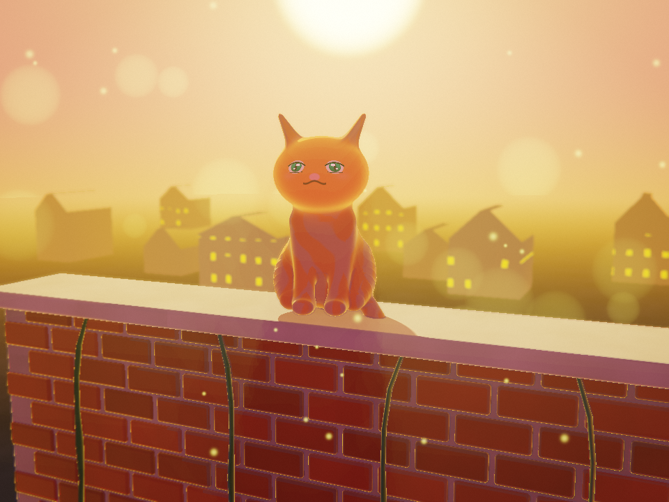
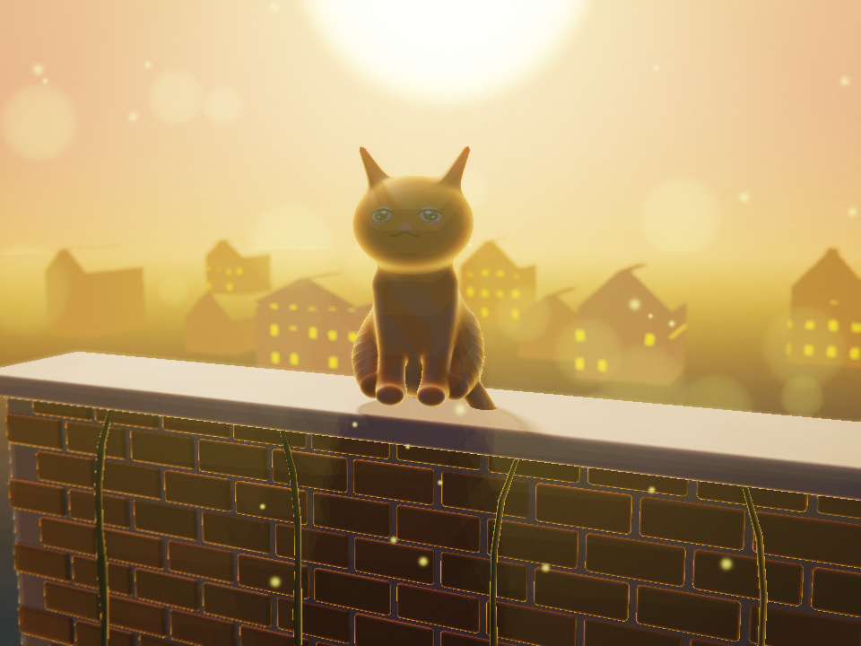
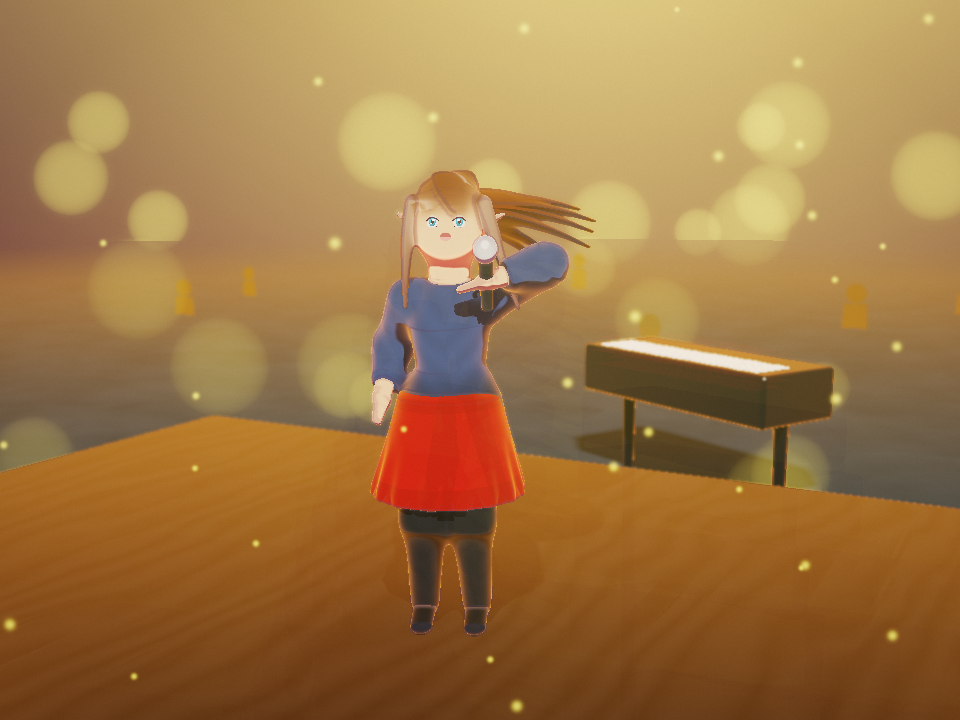
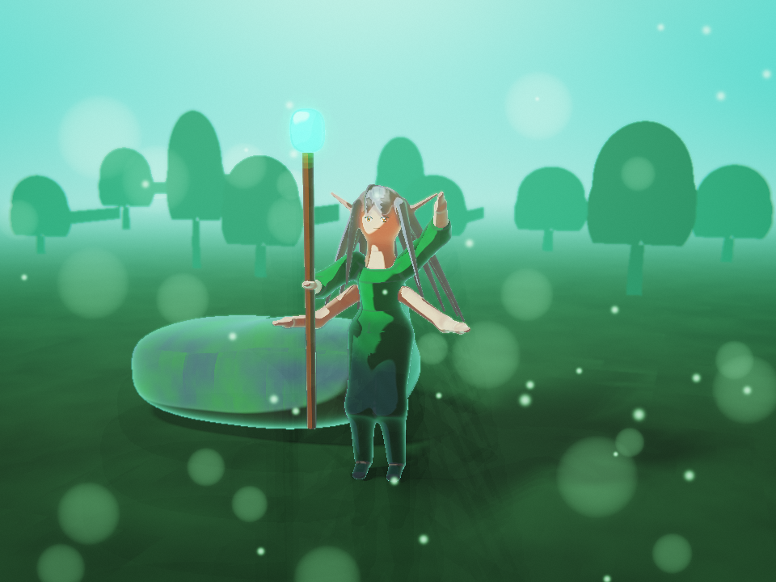
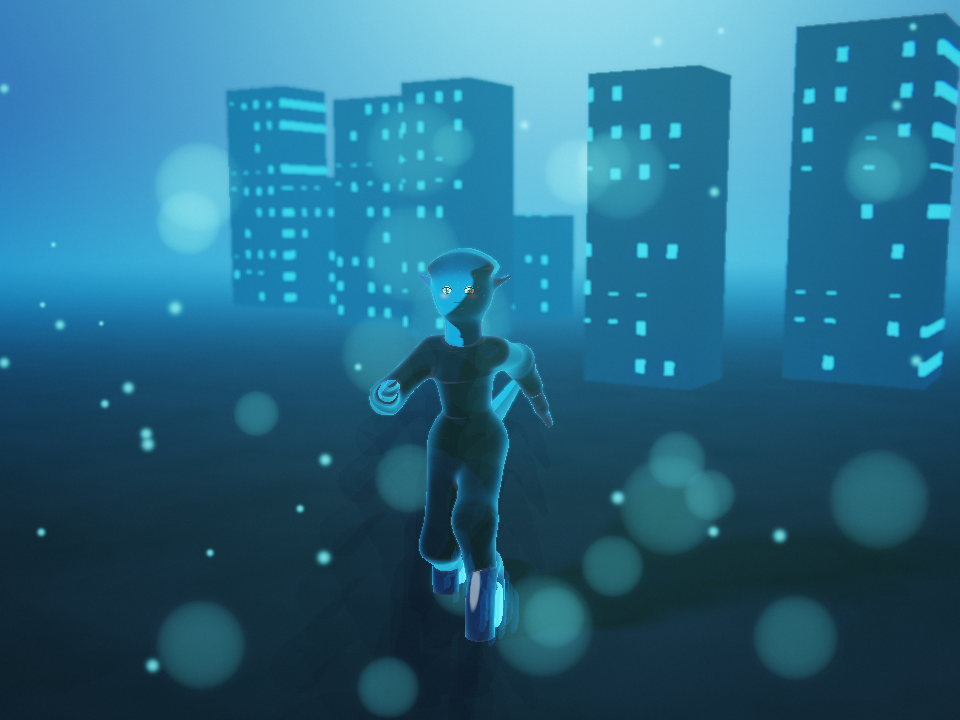

# PrismStudio

[](https://www.python.org/)
[]()
[]()
[]()
[]()

**PrismStudio** is a standalone pure-mathematical natural-language-to-image synthesis engine with **zero `ascii2image` code/imports** and **zero neural pixel diffusion**.

Instead of stitching disconnected primitives or hallucinating raster pixels, an LLM Scene Director compiles natural language into a compositional `SceneDNA` blueprint — driving swept Bézier super-splines with continuous Bishop frames, Spherical Harmonics ($L \le 3$) asymmetric heads, $C^2$ cubic `smin`/`smax` anatomical joints, Body-UV garment shells, and 3-zone cinematic lighting rendered on GPU (`ModernGL` OpenGL 3.3+) or an explicit-notify multi-core CPU fallback (`Numba` + `NumPy`).

---

## Visual Showcases (`960×720`)

| Showcase | Aesthetic Mode | Prompt Concept | Output |
| :--- | :--- | :--- | :---: |
| **Sunset Wall Cat** | `anime_npr` | Cute green-eyed orange tabby sitting on a high staggered brick wall at sunset with village bokeh |  |
| **Sunset Wall Cat** | `stylized_pbr` | Same compositional rig rendered with GGX specular, wrap SSS, and soft plush fur rim shading |  |
| **Anime Stage Singer** | `anime_npr` | Singing heroine with high ponytail, oversized indigo hoodie, tartan crimson skirt, handheld mic, piano, wooden stage & crowd bokeh |  |
| **Four-Armed Elf** | `anime_npr` | Four-armed elf mystic with pointed ears (`ear_length`), emerald tunic, back-anchored teal cloak & glowing crystal staff |  |
| **XLR8 Wheel-Legs** | `anime_npr` | Futuristic alien speedster with `omit_bones` feet replaced by glowing ankle `wheel_assembly` hubs, brow visor crest & cyber skyline |  |

---

## Core Capabilities

- **Dual Visual Modes:**
  - `anime_npr`: Sharp silhouette-aware cel shading, warm coral SSS shadow-edge terminator, anisotropic dual-lobe Kajiya-Kay hair sheen, and rim-modulated Sobel ink outlines.
  - `stylized_pbr`: Soft wrap SSS lighting, GGX microfacet specular highlights, metallic reflections, and velvety plush rim sheen.
- **Compositional Bone-Graph Anatomy (Open-Ended Creativity):**
  - 2-bone analytical Inverse Kinematics (IK) with quadruped (`quadruped`) and humanoid (`humanoid`) rigs connected via $C^2$ cubic smooth blending (`sminCubicMat`).
  - Arbitrarily omit body parts (`omit_bones`, e.g., feet for wheel-legs), attach extra multi-bone limbs (`extra_limb_chains`, e.g., four arms, wings, tentacles), or mount sockets (`mechanical_attachments`: `wheel_assembly`, `visor_helmet`, `magic_staff`, `handheld_mic`).
  - Pointed elf/animal ears, snouts, curls/tails, cranial $L \le 3$ Spherical Harmonics shaping, sculpted scalp caps & side bangs, and 2D analytical UV eyes (`anime_round`, `feline_slit`, `sharp_mystic`, `visor_glow`, `closed_happy`).
- **Single-Pass Body-UV Garment Pattern Cutter:**
  - Generates fitted or flared shells (`upper_torso`, `lower_skirt`, `full_dress`, `trousers`, `outer_coat`, `cloak`) seamlessly fused across shoulder and hip joints, with cosine pleats, hems, necklines, and 2D UV decals (`medical_cross`, `star_badge`, `safety_stripes`, `button_seam`, `lace_border`, `emblem_circle`).
- **3-Zone Cinematic World & 6-Stage Optical Pass:**
  - **Zone 1:** Staggered half-bond brick masonry with coping ledges & S-curve ivy, wooden stage decks, bounded-repetition piano keyboards, mossy stone outcrops, and trees snapped via topological DAG dependency solving (`on_top_of`, `beside`, `behind`).
  - **Zone 2:** Analytical midground silhouettes (dusk village cottages, city skyline with lit windows, concert silhouettes, multi-lobe forest canopy).
  - **Zone 3:** HDR sky dome, ground shadows, sun emitters, light-modulated ink outlines, foreground-protected Vogel disk DOF bokeh, radial god-rays, HDR bloom, chromatic aberration, ACES filmic tone mapping, and film grain.
- **Explicit-Notify Dual Execution Engine:**
  - **Primary:** Headless `ModernGL` OpenGL 3.3+ shaders packing the scene into a unified `RGBA32F` data texture atlas.
  - **Fallback:** Multi-core tiled `@njit(parallel=True, cache=True)` Numba + vectorized NumPy renderer + OpenCV Sobel/Vogel optical compositor. Whenever OpenGL falls back to CPU (or CPU mode is chosen), `RenderOutput.backend_notice`, CLI `stderr`, `RuntimeWarning`, and the Streamlit banner explicitly inform the user.

---

## Installation

```powershell
# From the repository root or prism_studio/
cd prism_studio
pip install -r requirements.txt

# Optional: editable install exposing the `prism-studio` console script
pip install -e . --no-build-isolation
```

**Dependencies:** `numpy>=2.0.0`, `Pillow>=10.0.0`, `opencv-python-headless>=4.9.0` (or `opencv-python`), `moderngl>=5.10.0`, `numba>=0.64.0`, `streamlit>=1.38.0` (optional UI), `pytest>=8.0.0` (tests).

---

## Quick Start

### 1. CLI

```powershell
# List all built-in zero-API showcase presets
python prism_studio/cli.py --list-presets

# Render a built-in preset at 960x720 (Anime NPR or Stylized PBR)
python prism_studio/cli.py --preset "Four-Armed Elf Mystic (Multi-Limb + Cloak)" --style anime_npr -o out/elf.png

# Generate from natural language using Groq / Ollama (with automatic offline fallback if unconfigured)
python prism_studio/cli.py "futuristic alien speedster hero with glowing ankle wheels" --style anime_npr --size 960x720 -o out/speedster.png

# Include the 320x240 VLM draft self-critique refinement pass before HD render
python prism_studio/cli.py "cute cat sitting on a high wall at sunset" --vlm-critique -o out/cat.png

# Force offline compositional planner or CPU fallback explicitly
python prism_studio/cli.py --offline --backend cpu --size 640x480 "elf mystic in forest" -o out/elf_cpu.png
```

All CLI renders write both `<out>.png` and `<out>.json` (the exact deterministic `SceneDNA`).

### 2. Streamlit Studio Web App

```powershell
streamlit run prism_studio/app.py
```

Includes preset selection, live camera/aperture/lighting/cel/exposure sliders (zero LLM cost when tweaking optics), dual `anime_npr` / `stylized_pbr` switching, raw `SceneDNA` JSON editor, optional `320×240` Draft-vs-Final VLM critique viewer, and explicit CPU fallback banners.

### 3. Python API

```python
from prism_studio import generate_image, PRESET_SCENES, render_scene_dna, scene_dna_from_dict

# Option A: Natural language prompt -> SceneDNA -> Render
res = generate_image(
    "cute cat sitting on a high wall at sunset",
    style_mode="anime_npr",
    width=960,
    height=720,
    use_vlm_critique=False,
    prefer_backend="auto",
)
with open("cat_wall.png", "wb") as f:
    f.write(res.png_bytes)

# Option B: Deterministic SceneDNA preset render
dna = scene_dna_from_dict(PRESET_SCENES["XLR8 Wheel-Leg Speedster (Alien Hybrid)"])
out = render_scene_dna(dna, width=960, height=720)
if out.backend_notice:
    print(out.backend_notice)
```

---

## Configuration (`.env`)

Copy `prism_studio/.env.example` to `prism_studio/.env` (or reuse a parent repository `.env`; `load_director_env()` checks both automatically):

| Variable | Default | Description |
| :--- | :--- | :--- |
| `LLM_PROVIDER` | `groq` | Active director backend (`groq` or `ollama`) |
| `GROQ_API_KEY` | *(empty)* | Groq Cloud API key (`allow_fallback=True` drops gracefully to offline director when omitted) |
| `GROQ_HOST` | `https://api.groq.com/openai/v1` | Groq OpenAI-compatible base URL |
| `GROQ_TEXT_MODEL` | `openai/gpt-oss-20b` | Text JSON Scene Director model (also honors `GROQ_MODEL` alias) |
| `GROQ_VISION_MODEL` | `meta-llama/llama-4-scout-17b-16e-instruct` | VLM Draft Critic model (`--vlm-critique`) |
| `OLLAMA_API_KEY` | *(empty)* | Optional bearer key for Ollama Cloud |
| `OLLAMA_HOST` | `http://localhost:11434` | Local or remote Ollama endpoint |
| `OLLAMA_TEXT_MODEL` | `gpt-oss:20b-cloud` | Ollama Scene Director model (also honors `OLLAMA_MODEL` alias) |
| `OLLAMA_VISION_MODEL` | `qwen2.5vl:7b` | Ollama VLM Draft Critic model |

---

## Observed Benchmarks

Measured on Windows with **Intel(R) UHD Graphics** (`OpenGL 3.3.0`) and **Numba `0.68.1`** multi-core CPU:

| Backend | Resolution | Scene Complexity | Measured Render Time | Peak Python Memory |
| :--- | :--- | :--- | :--- | :--- |
| `moderngl_gpu` *(1st pass / compile)* | `960×720` | `splines=15 solids=3` | `6.015s` | `5.4 MB` |
| `moderngl_gpu` *(Cat PBR)* | `960×720` | `splines=15 solids=3` | `1.456s` | `8.9 MB` |
| `moderngl_gpu` *(Stage Singer)* | `960×720` | `splines=37 solids=4` | `1.648s` | `9.0 MB` |
| `moderngl_gpu` *(Four-Armed Elf)* | `960×720` | `splines=40 solids=3` | `2.028s` | `9.0 MB` |
| `moderngl_gpu` *(XLR8 Speedster)* | `960×720` | `splines=18 solids=4` | `1.422s` | `9.0 MB` |
| `cpu_numba` *(1st JIT compile)* | `320×240` | `splines=15 solids=3` | `88.593s` | — |
| `cpu_numba` *(Cached fallback)* | `640×480` | `splines=15 solids=3` | `11.233s` | — |

---

## Project Layout

```
prism_studio/
├── app.py                          # Streamlit studio web UI
├── cli.py                          # Convenience CLI runner
├── pyproject.toml                  # Package metadata & `prism-studio` console script
├── requirements.txt                # Standalone runtime & dev dependencies
├── .env.example                    # Groq / Ollama environment template
├── prism_studio/
│   ├── __init__.py                 # High-level generate_image / render_scene_dna API
│   ├── cli_entry.py                # argparse CLI implementation
│   ├── schema/
│   │   ├── scene_dna.py            # Compositional SceneDNA dataclasses & JSON schema
│   │   └── patch_schema.py         # Bounded VLM ScenePatch delta applier
│   ├── math_ops/
│   │   ├── primitives.py           # Swept super-splines, Bishop frames, SH, C2 smin/smax, cloth, masonry
│   │   ├── decals_2d.py            # Analytical 2D UV anime/feline eyes & garment decals
│   │   └── materials.py            # sRGB/linear conversions & procedural shading helpers
│   ├── compiler/
│   │   ├── kinematics.py           # 2-bone IK limbs, extra_limb_chains, mechanical_attachments
│   │   ├── cranial_sh.py           # L <= 3 Spherical Harmonics head synthesis
│   │   ├── hair_fur.py             # Scalp cap, bangs & damped ponytail/lock ribbons
│   │   ├── garment_uv.py           # Body-UV cloth compiler & pelvis/footwear bindings
│   │   ├── world_zones.py          # Zone 1 props, Zone 2 midground silhouettes, Zone 3 emitters
│   │   ├── validator.py            # Structural validation & bounds clamping
│   │   ├── layout_solver.py        # DAG topological support placement solver
│   │   └── bytecode.py             # GPU/CPU uniform float32 RGBA32F atlas packer
│   ├── engine/
│   │   ├── glsl_Pass1_raymarch.glsl# Primary raymarcher, 2D eyes, cloth shells, cel/PBR shading
│   │   ├── glsl_Pass2_optics.glsl  # Ink outlines, Vogel DOF, god-rays, bokeh, bloom, ACES
│   │   ├── gpu_moderngl.py         # Persistent headless ModernGL renderer
│   │   ├── cpu_kernel.py           # Multi-core Numba @njit + NumPy CPU fallback kernel
│   │   ├── optics_cpu.py           # OpenCV/NumPy 6-stage optical post-FX parity pass
│   │   └── backend_manager.py      # GPU -> CPU orchestration with explicit user notice
│   └── director/
│       ├── llm_client.py           # Groq & Ollama text/vision JSON client
│       ├── scene_director.py       # Natural-language -> SceneDNA + offline presets & composer
│       └── vlm_critic.py           # 320x240 draft critique & ScenePatch refinement loop
└── tests/                          # Standalone automated pytest suite (15 tests)
    ├── conftest.py
    ├── test_backends_parity.py
    ├── test_director_and_critic.py
    ├── test_garments_and_decals.py
    ├── test_kinematics_anatomy.py
    ├── test_math_operators.py
    └── test_world_and_solver.py
```

---

## Automated Test Suite

```powershell
python -m pytest prism_studio/tests -v
```

All **15 tests across 6 test suites pass** (`15 passed, 1 warning in 7.88s`), verifying zero `ascii2image` imports inside `prism_studio/`, GPU & CPU fallback parity with explicit user warning notice, compositional 4-arm & wheel-leg IK kinematics, cranial SH continuity, $C^2$ `smin`/masonry/cloth clearance math, 2D eye & decal evaluators, DAG placement solving, offline scene composition, and mocked LLM/VLM critique loops.
